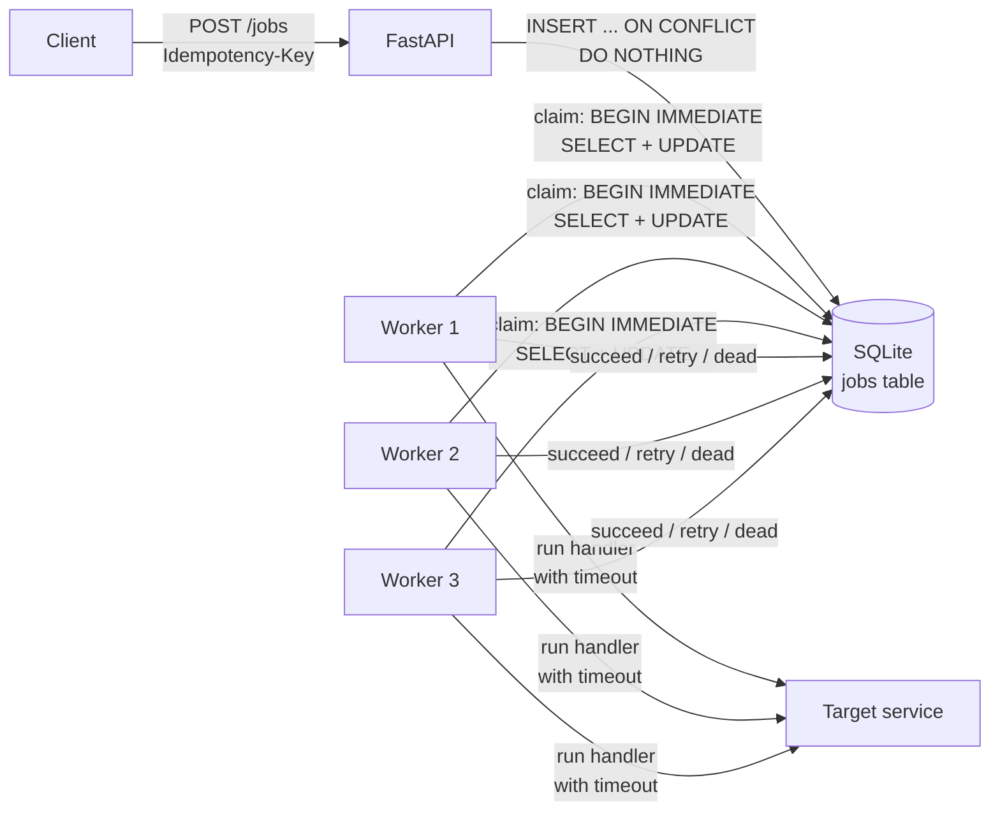

# Jobly

[](../../actions/workflows/ci.yml)

A small job queue that doesn't lose work. Clients submit jobs over HTTP, a pool of worker
processes runs them, and failures are handled properly: retries with exponential backoff
and jitter, per-attempt timeouts, a dead-letter queue, and recovery of jobs whose worker
crashed.

Built from scratch (FastAPI + SQLite, no Celery/RQ) to understand what those tools do
under the hood: safe job claiming, idempotency, at-least-once delivery, and failure handling.

## What it does

- **Idempotent submission.** `POST /jobs` with an `Idempotency-Key` header: retrying the same request never creates a second job. Reusing a key for a *different* request returns `409`.
- **Safe concurrency.** Any number of workers claim jobs atomically; no job is ever picked up by two workers at once.
- **Retries with backoff + jitter.** Failed attempts are rescheduled with exponentially growing, randomized delays so a recovering service isn't hit by a synchronized wave.
- **Dead-letter queue.** After `max_attempts`, a job is parked as `dead` with its last error. Inspect with `GET /jobs?status=dead`, requeue with `POST /jobs/{id}/retry`.
- **Per-attempt timeouts.** A hung handler can't block a worker forever.
- **Crash recovery.** If a worker dies mid-job, its lock expires and the job is requeued.
- **Observability.** `GET /stats` (JSON) and `GET /metrics` (Prometheus text format).
- **Permanent vs temporary failures.** A `404` from a webhook target goes straight to dead (retrying can't help); a `503` or `429` is retried.

## Architecture



A job moves through these states:

```
            claim                    handler ok
  queued ───────────▶ running ───────────────────▶ succeeded
    ▲                    │
    │  retry (backoff)   │ handler fails
    └────────────────────┤
                         │ attempts exhausted, or permanent error
                         ▼
                        dead ── POST /jobs/{id}/retry ──▶ queued
```

## Quick start

```bash
python -m venv .venv
source .venv/bin/activate            # Windows: .venv\Scripts\activate
pip install -r requirements-dev.txt
pytest                               # 44 tests

# terminal 1: the API
uvicorn app.main:app

# terminal 2: three worker processes
python -m worker --processes 3
```

Submit a job:

```bash
curl -X POST localhost:8000/jobs \
  -H 'Content-Type: application/json' \
  -H 'Idempotency-Key: order-1234-confirmation' \
  -d '{"type": "webhook_delivery", "payload": {"url": "https://example.com/hook", "body": {"order": 1234}}}'

curl localhost:8000/jobs/1
curl localhost:8000/stats
```

Docker (API + 3 workers sharing one volume):

```bash
docker compose up --build
```

### Try the failure handling

The API ships with a deliberately flaky endpoint (`/_demo/flaky`) that returns 500s and
hangs at random. With the API running, start workers with a short timeout and fast backoff,
then fire 20 jobs at it:

```bash
python -m worker --processes 3 --job-timeout 3 --backoff-base 1
python scripts/demo.py
```

## Demo output (real run)

20 webhook jobs aimed at a target that fails 40% of the time and hangs 15% of the time.
Full log in [`docs/demo-output.txt`](docs/demo-output.txt).

```
submitted 20 jobs -> http://127.0.0.1:8000/_demo/flaky?fail=0.4&hang=0.15&hang_seconds=8

queued=20 (ready 20, backing off 0)  running=0  succeeded= 0  dead=0
queued= 6 (ready 0, backing off 6)  running=2  succeeded=12  dead=0
queued= 0 (ready 0, backing off 0)  running=0  succeeded=18  dead=2

  succeeded 18 jobs   attempts used: [1, 1, 1, 1, 1, 1, 1, 1, 1, 1, 2, 2, 2, 2, 3, 3, 4, 4]
  dead       2 jobs   attempts used: [4, 4]

8 job(s) failed at least once and still succeeded thanks to retries.
```

One job that recovered, retried on a different worker each time:

```
23:56:07 worker-1 job 4 attempt 1/4: failed, retry in 0.5s (HTTP 500)
23:56:10 worker-1 job 4 attempt 2/4: failed, retry in 1.4s (HTTP 500)
23:56:13 worker-2 job 4 attempt 3/4: succeeded in 23ms
```

One that didn't, three hung attempts killed by the timeout, then a final failure, then the dead-letter queue:

```
23:56:10 worker-1 job 9 attempt 1/4: failed, retry in 0.9s (JobTimeout: timed out after 3.0s)
23:56:14 worker-3 job 9 attempt 2/4: failed, retry in 1.4s (JobTimeout: timed out after 3.0s)
23:56:19 worker-3 job 9 attempt 3/4: failed, retry in 2.8s (JobTimeout: timed out after 3.0s)
23:56:22 worker-1 job 9 attempt 4/4: out of attempts -> dead (HTTP 500)
```

## API

| Method | Path | Description |
|---|---|---|
| POST | `/jobs` | Submit a job. Body: `{type, payload, max_attempts?}`. Optional `Idempotency-Key` header. `201` new, `200` existing, `409` key reused with a different request, `422` invalid payload. |
| GET | `/jobs` | List jobs, newest first. `?status=dead` for the dead-letter queue, `?limit=`. |
| GET | `/jobs/{id}` | One job: status, attempts, last error, result, duration. |
| POST | `/jobs/{id}/retry` | Requeue a dead job with a fresh attempt budget. |
| GET | `/stats` | Queue depth, counts by status, average duration, success rate. |
| GET | `/metrics` | The same, in Prometheus text format. |
| GET | `/health` | Liveness. |

Job types: `webhook_delivery` (POST a payload to a URL), `url_check` (fetch a URL, record status and latency), `report_generate` (slow CPU-ish job for exercising timeouts and concurrency).

Add a type by writing one function in `worker/handlers.py`, registering it in `HANDLERS`, and adding it to `JobType` in `app/schemas.py`.

## Design decisions

**Idempotency enforced by the database.** A `UNIQUE` constraint on `idempotency_key` plus `INSERT ... ON CONFLICT DO NOTHING`. A Python-level "check if it exists, then insert" has a gap where two simultaneous requests both pass the check. The constraint can't be raced; a test fires 20 concurrent requests with one key and asserts exactly one job exists.

**Claiming with `BEGIN IMMEDIATE`.** The transaction takes SQLite's write lock *before* looking for a job, so two workers can't both select the same row. On Postgres this would be `SELECT ... FOR UPDATE SKIP LOCKED`. A test runs 8 threads draining 60 jobs and asserts every job was claimed exactly once.

**A database table as the queue, not Redis/Kafka.** Jobs, status, attempts and errors live in one place, and a job's state change is a single transaction. At this scale that's simpler and easier to inspect (`SELECT * FROM jobs`) than a broker. See limitations for where it stops working.

**Fencing token on completion.** A worker can only mark a job done if the job is still `running` with the same `locked_at` it claimed it with. If a slow worker's lock expires and the job is handed to someone else, the slow worker's late result is discarded instead of overwriting the newer attempt.

**Jitter on backoff.** `delay = ceiling/2 + random(0, ceiling/2)` with `ceiling = min(300s, base * 2^(attempt-1))`. Without jitter, jobs that failed together retry together.

**Validate at submission.** A webhook job without a URL is rejected with `422` immediately rather than failing five times first.

**Permanent errors skip retries.** Retrying a request the target rejected with `404` just wastes attempts. `408` and `429` are treated as temporary.

**Lock timeout > job timeout.** The CLI refuses a lock timeout shorter than the job timeout, otherwise healthy slow jobs would get stolen.

## Known limitations

- **At-least-once delivery.** A job can run more than once (e.g. a worker finishes the work then crashes before recording it). Handlers should be idempotent; for webhooks, send the job's idempotency key to the receiver so *it* can de-duplicate.
- **Timeouts abandon, not kill.** Python can't kill a thread. A timed-out handler stops being waited on and the attempt counts as failed, but its thread runs to completion in the background. Handlers also set their own network timeouts. A subprocess-per-job design would allow real termination at the cost of startup time.
- **Single node.** SQLite lets many worker processes on one machine share the queue. It does not work across machines, and `docker compose` sharing the file through a volume is only reliable on a Linux host. Scaling out means moving to Postgres (`SKIP LOCKED`) or a broker (Redis Streams, SQS, Kafka).
- **No authentication, no URL allowlist.** Anyone who can reach the API can make workers call arbitrary URLs (SSRF risk). Don't expose it as is.
- **Polling.** Idle workers poll every 0.5s rather than being pushed work.
- **Finished jobs are never deleted.** A real deployment would add retention.
- Docker files and the CI workflow are provided but were not executed during development; the application itself was run and tested directly.

## Project layout

```
app/
  main.py        HTTP API
  store.py       all queue logic: create, claim, complete, fail, recover, metrics
  db.py          schema and connections
  schemas.py     request/response models and payload validation
  flaky.py       unreliable endpoint for demos
worker/
  runner.py      worker loop, timeouts, outcome handling
  handlers.py    job types
  __main__.py    CLI: python -m worker
scripts/demo.py  failure-handling demo
tests/           44 tests (claim races, backoff, DLQ, recovery, timeouts, API)
docs/            real demo output
```
